#  Production of Aniline by Vapour-Phase Catalytic Hydrogenation of Nitrobenzene

  <b>ChE453 – Capstone Project (Group 14)</b> 
  Department of Chemical Engineering, Indian Institute of Technology Kanpur

---

## 1. Project Overview

This project presents the design, simulation, heat integration, and economic evaluation of a continuous industrial process for the production of aniline by the vapour-phase catalytic hydrogenation of nitrobenzene.

Aniline (C6H5NH2) is a bulk aromatic amine and a key intermediate of the organic chemical industry. About 85% of world production is used to manufacture MDI (methylene diphenyl diisocyanate) for rigid polyurethane foam, insulation panels, and adhesives. The remainder goes to rubber processing chemicals, agrochemicals, dyes, and pharmaceutical intermediates. The global aniline market was valued at about USD 8.2 billion in 2026 and is projected to reach about USD 12.2 billion by 2033 (CAGR of about 5.8%), with Asia-Pacific holding roughly 39% of the market.

The work was carried out in six bi-weekly reports (9 August to 8 November 2026):

| Report | Date | Theme |
|--------|------|-------|
| 1 | 9 August 2026 | Route selection, material balance, input-output economics, thermodynamic model selection and regression |
| 2 | 23 August 2026 | Flowsheet development and convergence in Aspen Plus |
| 3 | 6 September 2026 | Distillation redesign, captive gas-turbine power plant, cooling water loop, utility costing |
| 4 | 27 September 2026 | Kinetic reactor model, separator vessel design, heat exchanger design, aniline-nitrobenzene regression, full recycle convergence |
| 5 | 25 October 2026 | Pinch analysis, heat exchanger network, capital cost, techno-economic analysis |
| 6 | 8 November 2026 | Innovative component: nitrobenzene feed saturator, reactor steam drum reset, back-pressure turbine study |

The battery limits start from purchased nitrobenzene. Nitration of benzene is outside the project scope.

---

## 2. Reaction Chemistry

**Main reaction**

> C6H5NO2 + 3 H2 → C6H5NH2 + 2 H2O  (ΔHr ≈ −443 kJ/mol)

**Side reactions (both proceed through aniline)**

> C6H5NH2 + 3 H2 → C6H11NH2  (over-hydrogenation to cyclohexylamine)
> C6H5NH2 + H2 → C6H6 + NH3  (hydrogenolysis of the C–N bond)

Key characteristics:

- Vapour-phase, catalytic (Cu or Ni supported catalyst; Cu on silica in the final design), continuous operation.
- Strongly exothermic. The hand calculation of Report 1 gives 17.6 MW at design capacity. The kinetic reactor of Report 4 releases 18.75 MW, of which 15.93 MW is removed by the coolant after the feed heating duty is netted off.
- Design selectivity (moles of nitrobenzene reacted basis): 95% aniline, 1.5% cyclohexylamine, 3.5% benzene and ammonia. The kinetic reactor of Report 4 gives 94.06 / 1.76 / 4.19%.
- Route selected over liquid-phase hydrogenation, the Béchamp process, and phenol amination for continuous operation, high selectivity (95–98%), water as the only bulk by-product, and recoverable reaction heat.

---

## 3. Project Objectives

1. Identify and justify a suitable industrial process route for aniline production.
2. Specify feed and product streams and close the overall material balance.
3. Perform an input-output cost analysis as a preliminary economic screen.
4. Select and validate a thermodynamic model, including in-house parameter regression.
5. Develop the process flow diagram and synthesis logic (recycle structure and separation sequencing).
6. Build, specify, and converge the flowsheet in Aspen Plus, and verify material and energy balance closure.
7. Design and sequence the distillation columns to meet the product specification.
8. Design a gas-turbine captive power plant and a cooling water loop, and perform utility costing.
9. Replace the stoichiometric reactor with a kinetic model, size the remaining separators, and design one heat exchanger in detail.
10. Design a heat exchanger network using pinch technology, and carry out a detailed techno-economic analysis.
11. Develop and evaluate an innovative process improvement.

---

## 4. Design Basis and Specifications

| Stream | Specification | Temperature | Pressure |
|--------|---------------|-------------|----------|
| Aniline product | ≥ 99.9 wt%; water < 0.1 wt%; nitrobenzene < 5 ppm | 40 °C | 1.0 bar |
| Nitrobenzene feed | ≥ 99.5 wt%, technical grade | Ambient | 1.0 bar |
| Hydrogen make-up | 99.9 mol%, balance N2 | Ambient | 5 bar |
| Treated wastewater | Aniline < 1 ppm before discharge | 40 °C | 1.0 bar |

**Design basis**

- Nominal plant capacity: 100,000 t/y aniline.
- Operating time: 8,000 h/y was assumed in Report 1 (12.5 t/h). From Report 4 the final basis is **8,200 h/y**, and all annual figures in Reports 5 and 6 use it. The simulated product stream of 12,183 kg/h corresponds to about 99,900 t/y.
- Nitrobenzene conversion per pass: 99% assumed in Reports 1 to 3; 99.5% calculated by the kinetic reactor from Report 4.
- Hydrogen-to-nitrobenzene molar ratio at the reactor inlet: 10:1 assumed; about 9:1 in the converged flowsheet owing to nitrogen build-up in the recycle gas.

**Market prices used (August 2026)**

| Item | Price |
|------|-------|
| Aniline | Rs. 155,000/t (USD 1,632/t) |
| Nitrobenzene | Rs. 85,500/t (USD 900/t), bulk/term procurement target |
| Hydrogen | Rs. 185,000/t (USD 1,947/t), on-site SMR production cost basis |
| Natural gas | USD 10/MMBtu |

Exchange rate: Rs. 95 per USD. Costs in Reports 5 and 6 are in 2023 US dollars (CEPCI 797.9).

---

## 5. Process Development Summary

### 5.1 Report 1: Process Identification, Material Balance and Thermodynamics

- Overall material balance closed at **134.22 kmol/h** aniline from **141.28 kmol/h** nitrobenzene reacted, with the hydrogen loop (make-up, recycle, purge) balanced explicitly. The purge is about 2% of the make-up and carries away about 1.9% of the purchased hydrogen.
- Specific consumption: 1.392 t nitrobenzene and 70.2 kg hydrogen per tonne of aniline.
- Reaction heat computed from actual reaction extents: **17.6 MW** (main reaction 17,385 kW, side reactions about 182 kW).
- Input-output screen: gross contribution of **Rs. 23,041 per tonne** of aniline (14.9% margin). Nitrobenzene accounts for about 77% of revenue.
- **Thermodynamic model:** NRTL-RK (NRTL for the liquid phase, Redlich-Kwong for the vapour). H2 and N2 are Henry components.
- The default Aspen databank parameters for the aniline-water pair were found unreliable (sourced from a vapour-liquid data bank although the pair splits into two liquid phases, and valid only over 99–168 °C against the 40 °C decanter condition).
- **In-house NRTL regression** of the aniline-water pair on NIST TDE liquid-liquid data (three-parameter fit, b(ji) fixed at zero after diagnosing over-parameterisation in a four-parameter attempt).
- Independent validation against held-out azeotropic data: predicted azeotrope at **99.34 °C, x(aniline) = 0.0368** against experimental **98.97 °C, x(aniline) = 0.04** (agreement within 0.37 K).
- Confirmed a **heterogeneous aniline-water azeotrope**, so a decanter, not a distillation column, is used to break this pair.

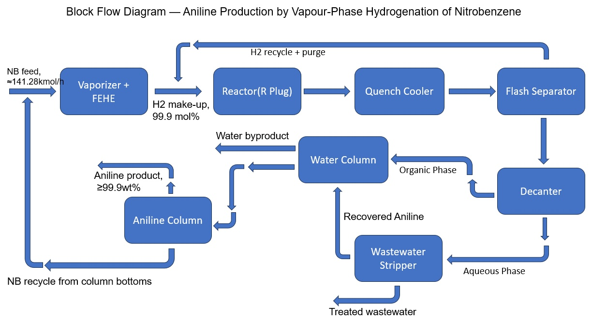

*Figure 1. Block flow diagram of the aniline plant, with the three recycle streams labelled (Report 1).*

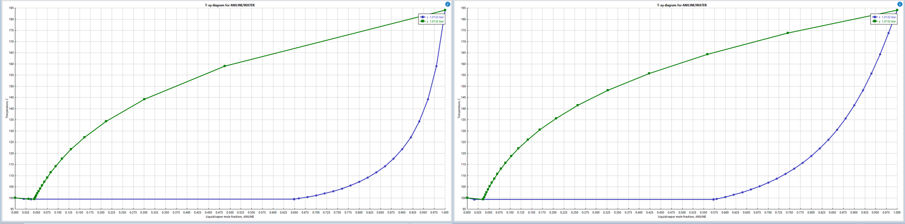

*Figure 2. T-xy diagram for aniline-water before regression (left) and after regression (right). The flat portion is the two-liquid-phase region (Report 1).*

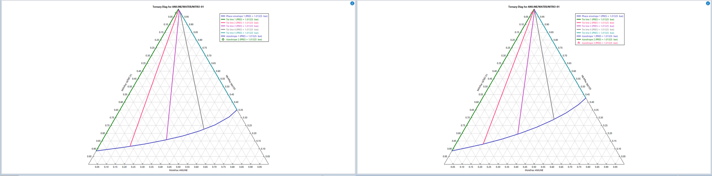

*Figure 3. Ternary diagram for aniline/water/nitrobenzene before regression (left) and after regression (right) (Report 1).*

### 5.2 Report 2: Flowsheet Development and Convergence in Aspen Plus

- Operating conditions fixed: reactor at **300 °C, 3 bar**; flash and decanter at **40 °C**.
- **Synthesis logic:** vapour-liquid split first (flash), then liquid-liquid split (decanter) to break the aniline-water azeotrope, then distillation of the residue.
- **Separation sequence:** DEC (decanter), COL-1 (water column, three-phase RadFrac), COL-2 (aniline column, vacuum at 0.2–0.3 bar to avoid darkening of aniline), STRIP (atmospheric stripping of the aqueous phase).
- Flowsheet built from RStoic, Flash2, FSplit, Compr, Decanter, and three RadFrac columns, and converged with Wegstein tear-stream convergence.
- Mass balance closure **0.004%** (0.7 kg/h in 18,300 kg/h); energy balance closure **0.003%**.
- Product at this stage: 97.04 wt% aniline, flagged for sharper column design.
- Total heating 22.48 MW against total cooling 45.16 MW and a 17.57 MW reaction exotherm.

### 5.3 Report 3: Distillation Redesign, Captive Power Plant and Utilities

**Distillation redesign**

- **COL-1** identified as an over-designed dryer (relative volatility of water to aniline about 100) and cut from 20 to **12 stages**. The invalid total condenser, which was driving to −263 °C to condense non-condensable H2 and N2, was replaced by a **partial-vapour-liquid condenser** with a separate vent.
- A design specification on bottoms water content (x(H2O) = 0.002) fixed the drying duty and required a shift from 10 bar to 16 bar steam for the reboiler.
- Aniline lost overhead from COL-1 cannot be recovered by more reflux because the overhead sits at the heterogeneous azeotrope itself.
- **ANRECOV** rerouted to the decanter through a new condenser (ARCOND), shifting 7.18 MW of duty from 16 bar steam to cooling water.
- **COL-2** re-specified on a fixed bottoms rate, cutting aniline returned to the reactor from 13.39 to 0.83 kmol/h and restoring reactor selectivity to design values (94.95 / 1.53 / 3.52%).
- A cyclohexylamine side draw was shown not to work because cyclohexylamine and aniline have near-identical relative volatility despite a 49.6 K boiling-point gap.
- **STRIP boilup ratio** raised from 1.0 to 3.0, cutting aniline in the wastewater by a factor of 177 (2,135 to 154 ppm).

**Key results of Report 3:** aniline recovery 98.09%; product 99.39 wt% aniline and 0.04 wt% water at 40 °C and 1.0 bar; mass balance closure 0.00006%; energy balance closure 0.005%.

**Gas-turbine captive power plant**

- Open Brayton cycle sized on the plant purge plus natural gas make-up, with exhaust heat recovery (Peng-Robinson, separate Aspen file). Combustion modelled with a Gibbs-minimisation (RGibbs) block.
- Turbine inlet temperature about 1,154 °C at 200% excess air.
- **709.1 kW** net electrical output against a demand of 708.5 kW; simple-cycle efficiency 31.1%; combined heat-and-power efficiency 82.7%.
- CO2 emissions 363 kg/h (0.030 t CO2 per tonne of aniline).

**Cooling water loop**

- Circulation of 1,578 t/h at a 12 K range (30 to 42 °C), verified by hand calculation and by Aspen Plus (agreement within 0.39%). Make-up 43.6 t/h.
- The decanter duty was found infeasible on the main cooling-water header (temperature cross at 40 °C).

**Study-level utility costing:** thermal utility cost USD 9.22 million/y; total including electricity USD 9.73 million/y (about USD 99.4/t aniline); steam is 97.3% of the thermal utility cost.

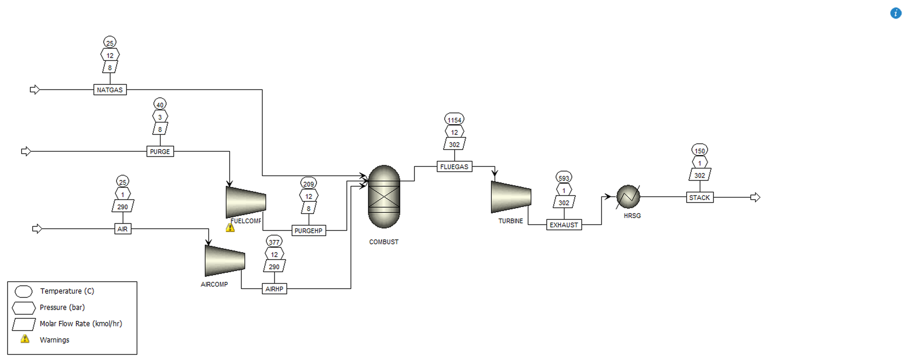

*Figure 4. Gas-turbine captive power plant as converged in Aspen Plus, annotated with temperature (°C), pressure (bar), and molar flow (kmol/h) (Report 3).*

### 5.4 Report 4: Kinetic Reactor, Separators, Heat Exchanger and Full Recycle Simulation

**Kinetic reactor (RPlug)**

- Power-law kinetics on a Cu/silica catalyst, with the activation energy of the main reaction (35 kJ/mol) taken from Petrov, Kumbilieva and Kirkov. The two side-reaction rate constants are fitted to reproduce the Report 3 selectivity and are not independently regressed.
- Result: **99.49% conversion** per pass; selectivities 94.06 / 1.76 / 4.19% to aniline, cyclohexylamine, and benzene; reactor releases 18.75 MW, of which 2.82 MW heats the feed and **15.93 MW** is removed by the coolant.
- **Tube diameter selection.** On the same packed bed volume, 52.5 mm tubes give a hot-spot of 640.4 °C, far above the copper sintering limit (taken as 400 °C, below the Tammann temperature of 406 °C). 25 mm tubes (9,700 tubes, 2.0 m long, 11,430 kg catalyst) hold the peak at **390.7 °C**, at the cost of about 0.15 bar extra pressure drop.

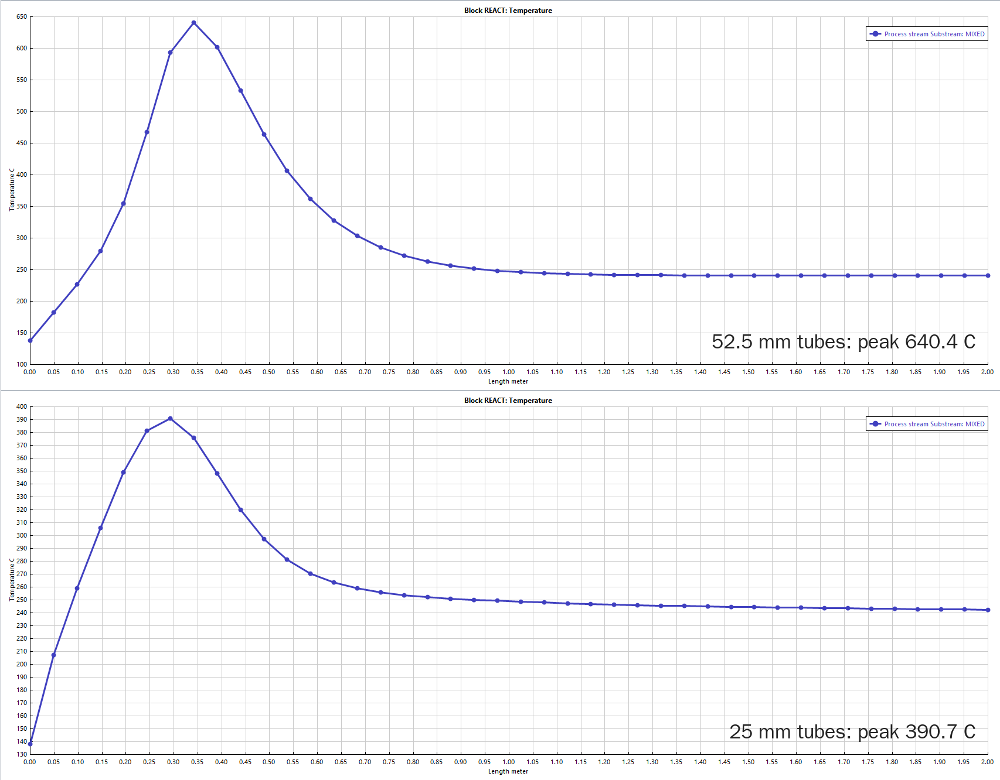

*Figure 5. Axial temperature profile in the catalyst bed: 52.5 mm tubes (top) and 25 mm tubes (bottom) (Report 4).*

**Other separators**

| Vessel | Basis | Result |
|--------|-------|--------|
| Flash drum | Souders-Brown, 5 min holdup | 0.92 m diameter, 3.8 m tangent-to-tangent; runs at 79% of flooding velocity |
| Decanter | Stokes settling, 150 µm droplet, L/D = 5 | 1.25 m diameter, 6.25 m long; 15.0 min residence against 12.8 min settling time |
| Second decanter on WATOVHD | Open loop | Recovers 76.4% of the aniline in the stream (1.99 kmol/h, 185 kg/h) |
| Thermal oxidiser (VENT) | 870 °C, at least 98% destruction | 1.6 m diameter, 4.8 m long, 1.07 s residence, no support fuel needed |
| Carbon adsorber (wastewater) | 30-day cycle, two beds lead-lag | 3,400 kg carbon per bed, 1.2 m diameter, 6.7 m high |

**Heat exchanger B3 (ARCOND, aniline recovery condenser)** designed in Aspen Exchanger Design and Rating: TEMA AES, 721 tubes, 7.66 MW duty, required area 132.87 m2, installed area 147.03 m2 (10.7% over-surface). Duty agrees with the flowsheet value within 0.5%.

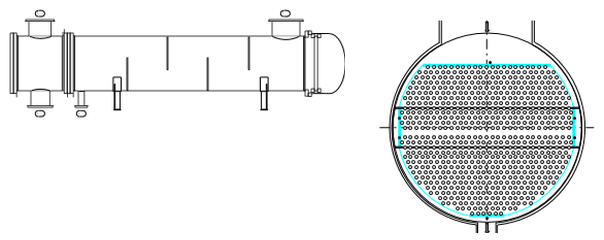

*Figure 6. Exchanger B3 from Aspen EDR. Left: setting plan. Right: tube layout of the 721 tubes on 25 mm, 30° triangular pitch (Report 4).*

**Aniline-nitrobenzene regression.** Four binary vapour-liquid data sets (NIST TDE, 43–210 °C) were regressed by maximum likelihood (Britt-Luecke algorithm, Deming initialisation). The databank parameters cover only 83–99 °C whereas COL-2 runs at 129–145 °C. Both temperature-dependent terms changed sign, showing that the pair is closer in volatility than the databank predicted.

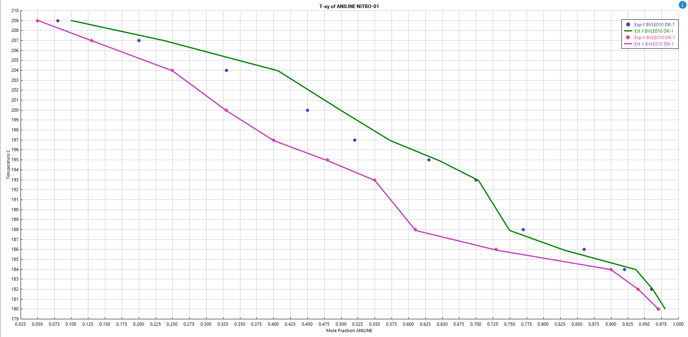

*Figure 7. Regressed NRTL fit for the aniline-nitrobenzene pair, data set BVLE010. Points are experimental and lines are the fitted model (Report 4).*

**COL-2 study.** With the regressed pair, reflux ratio and bottoms rate had a weak effect, while stage count controlled the split. Increasing COL-2 from 15 to **25 stages** at reflux ratio 3 and 3 kmol/h bottoms gave **313 ppm** nitrobenzene (from 1,466 ppm) and **99.45 wt%** aniline with no additional reboiler duty.

**Full recycle simulation.** Four recycle loops (H2RET, S3, LIQ-OUT, ARLIQ) were converged with Wegstein. Overall mass balance closure: **7 ppm** (0.12 kg/h on 18,300 kg/h).

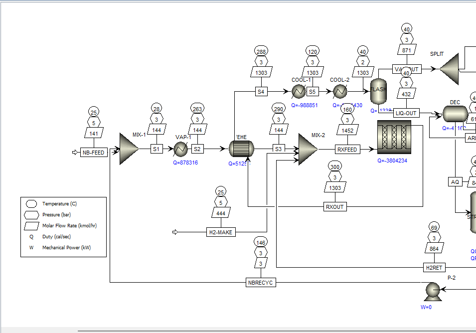

*Figure 8. Converged Aspen Plus flowsheet, feed and reaction section: nitrobenzene feed through the reactor, flash drum, and decanter. Annotated with temperature (°C), pressure (bar), molar flow (kmol/h), and duty (cal/s) (Report 4).*

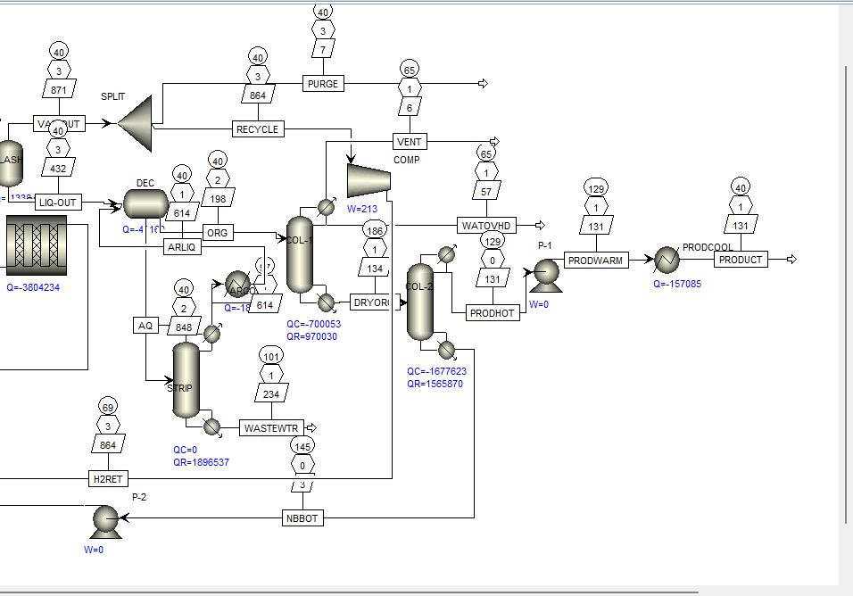

*Figure 9. Converged Aspen Plus flowsheet, separation section: decanter, stripper, COL-1, COL-2, and product cooler, with the hydrogen and nitrobenzene recycles returning to the feed section (Report 4).*

### 5.5 Report 5: Pinch Analysis, Heat Exchanger Network and Techno-Economics

**Pinch analysis**

- The stream data were taken from the converged flowsheet through the Energy Analysis of Aspen Plus into Aspen Energy Analyzer, after three corrections (the reactor entered as a hot stream at 300 °C rather than a cold stream, DEC and FLASH duties at 40 °C removed, and the VAP-1 inlet temperature corrected).
- At ΔTmin = 10 K the plant is a **threshold problem**: minimum hot utility **0 MW** and minimum cold utility **21.33 MW**. A manual problem-table calculation gives 21.30 MW. The reactor heat at 300 °C exceeds the demand of every heater and reboiler.
- Aspen Energy Analyzer produced a 17-exchanger network (design A Design2) that meets the target exactly.

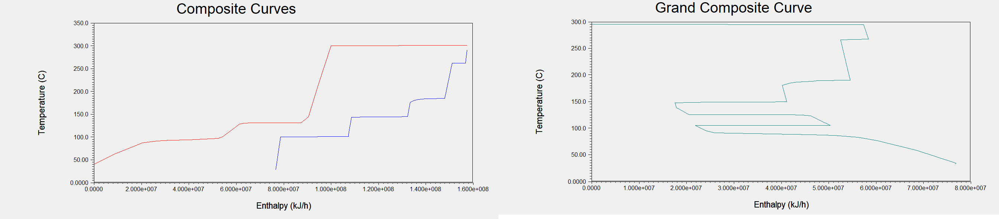

*Figure 10. Composite curves (left) and grand composite curve (right) at ΔTmin = 10 K, from Aspen Energy Analyzer (Report 5).*

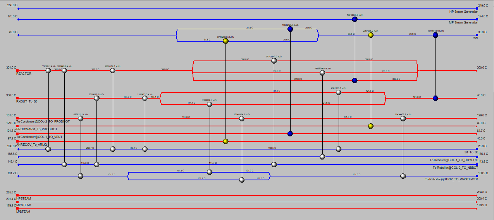

*Figure 11. Heat exchanger network A Design2 from Aspen Energy Analyzer, ΔTmin = 10 K. Red lines are hot streams, blue lines are cold streams and utilities (Report 5).*

**Final network.** The bed temperature limit prevents the reactor coolant from being as hot as Aspen assumed, so 40 bar steam (250.4 °C) is raised on the reactor shell. The final network has 14 exchangers, and the COL-2 condenser drives the stripper reboiler directly. The residual **1.80 MW** of purchased 70 bar steam is the vaporisation of nitrobenzene at 262 °C, which lies above the 40 bar steam temperature.

**Column sizing for costing (Fair flooding, 80% of flood, 70% tray efficiency)**

| Column | Diameter | Sieve trays | Height | Pressure |
|--------|----------|-------------|--------|----------|
| COL-1 | 1.85 m | 15 | 13.0 m | 1.1 bar |
| COL-2 | 3.50 m | 33 | 24.0 m | 0.2 bar |
| STRIP | 1.75 m | 10 | 10.0 m | 1.0 bar |

### 5.6 Report 6: Innovative Component, the Nitrobenzene Feed Saturator

**Problem.** In Report 5, nitrobenzene is boiled alone at 263 °C and 3 bar, which required purchased 70 bar steam (1.80 MW; 4,307 kg/h; USD 1.24 million/y). The reactor feed also reached the bed at a vapour fraction of 0.988 (about 17 kmol/h of liquid, mostly nitrobenzene), and the 40 bar steam drum drove the bed hot-spot above the copper sintering limit.

**Idea.** Let the hydrogen loop carry the nitrobenzene. At a partial pressure of only 0.29 bar in the reactor feed, nitrobenzene reaches its dew point at **163.9 °C** (Aspen Plus) instead of boiling at 263 °C. The nitrobenzene is evaporated into the recycle and make-up hydrogen in a packed saturator column (C-101) that is heated through a liquid-phase pump-round heater (H-101) on reactor steam.

**Results**

- The 70 bar steam import falls to **zero**. The reactor feed becomes fully vapour (vapour fraction 1.000, 170 °C).
- Saturator: 2.8 m diameter, 3.0 m of 50 mm Pall rings, 7.0 m tangent-to-tangent; 160 t/h pump-round; H-101 duty 4.18 MW over 81 m2. The gas leaves dry at 168.9 °C, 3.8 K above its dew point. Nitrobenzene that the gas cannot carry stays in the sump and cannot reach the catalyst.
- No nitrobenzene is boiled on a steam-heated wall, and the hottest nitrobenzene liquid falls from 290 °C to 176 °C. Heavy impurities leave in a sump blowdown.
- With no user above 176 °C, the reactor steam drum is reset from 40 bar (250.4 °C) to **33 bar (239.2 °C)**. A calibrated one-dimensional bed model gives a hot-spot of **388 °C** (12 K margin) against **422–423 °C** at 40 bar (above the 400 °C limit). The peak rises 3.2 K per kelvin of shell temperature, so the drum pressure, not the feed temperature, decides whether the bed stays within the limit.
- Full flowsheet test with a 170 °C feed: product 99.44 wt% aniline and 306 ppm nitrobenzene, essentially unchanged.
- Back-pressure turbines on the 16 bar and 10 bar letdown were studied (Aspen Plus at 40 bar, steam tables at 33 bar). The incremental NPV is about zero (−USD 0.14 million at 40 bar; −USD 0.02 million at 33 bar), so they are **not adopted**.

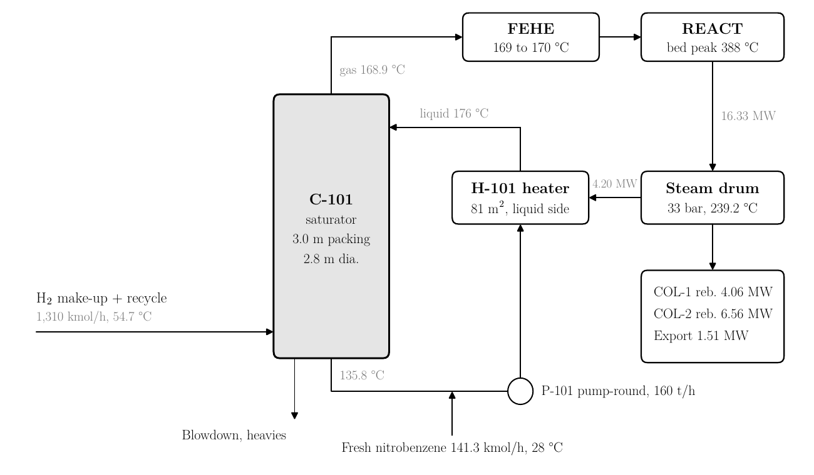

*Figure 12. Proposed feed section and reactor steam header. The pump-round carries all the steam heat into the column as hot liquid, the gas is heated and saturated by contact, and the 33 bar reactor drum supplies every heating duty on the plant (Report 6).*

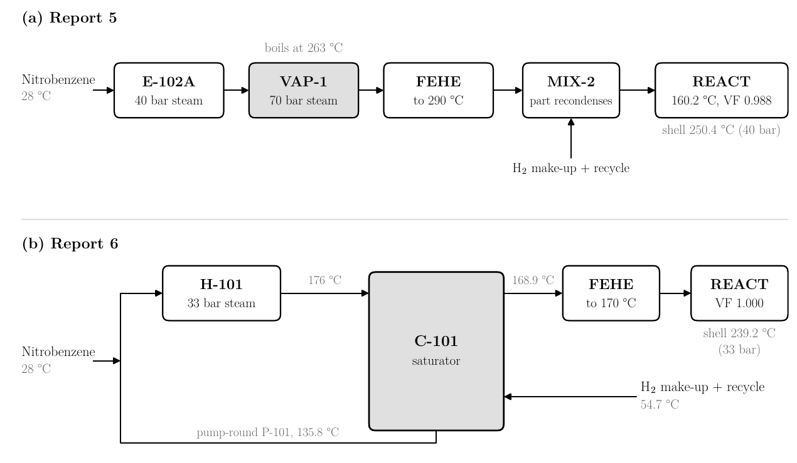

*Figure 13. Feed path to the reactor in Report 5 (a) and in Report 6 (b) (Report 6).*

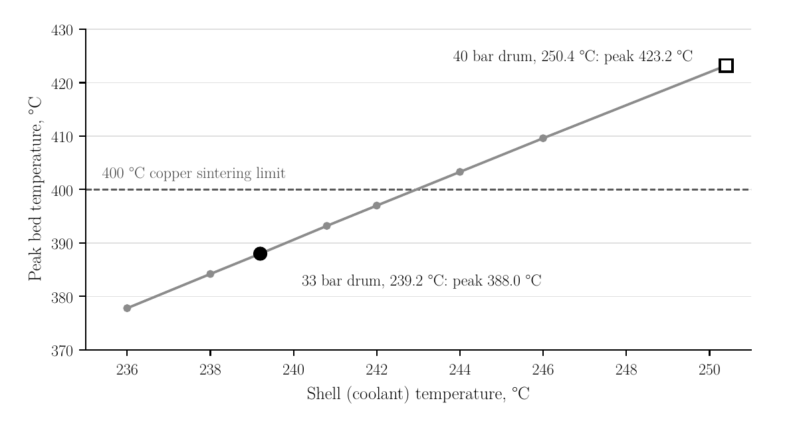

*Figure 14. Peak bed temperature from the calibrated one-dimensional bed model, 170 °C feed, 25 mm tubes. This result is preliminary until confirmed with a non-isothermal RPlug in Aspen Plus (Report 6).*

---

## 6. Final Design Summary

**Reaction section**

- Multitubular fixed-bed reactor: 9,700 tubes of 25 mm inside diameter, 2.0 m long, Cu/silica catalyst (6 mm particles, 11,430 kg), 300 °C and 3 bar, reactor shell raising 33 bar steam.
- Feed: fresh nitrobenzene, hydrogen make-up, and recycle gas. Nitrobenzene is evaporated into the hydrogen in the saturator C-101, with the FEHE superheating the gas to 170 °C.
- Hydrogen recycle loop with compressor and a controlled purge (about 0.9% split) to limit nitrogen build-up.

**Separation section**

- Flash drum, then decanter (first), exploiting the heterogeneous aniline-water azeotrope.
- COL-1: 12-stage water column (dryer) with a partial-vapour-liquid condenser; vent to the thermal oxidiser.
- COL-2: 25-stage vacuum aniline column (0.2 bar), reflux ratio 3, bottoms 3 kmol/h recycled to the reactor.
- STRIP: wastewater stripper at boilup ratio 3, followed by a lead-lag activated carbon polishing bed.
- ANRECOV condensed in ARCOND (exchanger B3) and returned to the decanter.
- Four recycle loops: hydrogen gas, unconverted nitrobenzene, flash liquid, and recovered aniline.

**Utilities and power**

- Reactor steam supplies every heating duty (COL-1 and COL-2 reboilers through 16 bar and 10 bar letdown, the saturator heater, and the stripper reboiler through the COL-2 condenser integration) with 1.51 MW of steam exported.
- Gas-turbine captive power plant on the purge stream (745 kW simulated; about 757 kW scaled to the final purge) covers the plant demand of about 608 kW.
- Cooling water circulation of 1,327 t/h after heat integration.

---

## 7. Performance Against Specification

| Quantity | Required | Report 3 | Report 4 | Report 6 (final) |
|----------|----------|----------|----------|------------------|
| Aniline purity | ≥ 99.9 wt% | 99.39 wt% | 99.45 wt% | 99.44 wt% |
| Nitrobenzene in product | < 5 ppm | 1,466 ppm | 313 ppm | 306 ppm |
| Water in product | < 0.1 wt% | 0.04 wt% | 0.04 wt% | 0.04 wt% (met) |
| Aniline in wastewater | < 1 ppm | 154 ppm | 216 ppm into carbon bed | 216 ppm into carbon bed (bed designed for < 1 ppm; breakthrough curve pending) |
| Cyclohexylamine in wastewater | not specified | 3.7 wt% | 4.28 wt% | 4.28 wt% (biological treatment costed) |
| Mass balance closure | – | 0.00006% | 0.0007% (7 ppm) | Not restated |
| Product temperature and pressure | 40 °C, 1.0 bar | 40 °C, 1.0 bar | 40 °C, 1.0 bar | 40 °C, 1.0 bar |

The aniline purity and nitrobenzene specifications are **not yet met**. The binding impurity in the product is cyclohexylamine (about 0.48 wt%).

---

## 8. Utilities and Heat Integration

| Metric | Report 3 | Report 4 | Report 5 (integrated) | Report 6 (final) |
|--------|----------|----------|-----------------------|------------------|
| Heating (purchased steam), MW | 20.40 | 22.24 | 1.80 | 0 |
| Cooling water circulation, t/h | 1,578 | 1,691 | 1,327 | 1,327 (unchanged) |
| Reactor heat | 15.4 MW, left for steam-raising credit | 15.93 MW, no utility assigned | 15.93 MW raising 40 bar steam | 16.33 MW raising 33 bar steam |
| Exchangers in network | – | – | 14 | 13 plus saturator C-101 |

Utility cost before and after heat integration (Report 5, with the reactor and COOL-1 placed on cooling water in the base case for a fair comparison): **USD 10.43 million/y falling to USD 0.67 million/y**, a saving of USD 9.75 million/y. The Report 6 saturator removes the remaining 70 bar steam purchase and gives a further net saving of USD 0.79 million/y.

---

## 9. Economic Results

**Preliminary input-output screen (Report 1)**

| Metric | Value |
|--------|-------|
| Aniline revenue | Rs. 155,000/t |
| Total raw materials cost | Rs. 131,959/t |
| Gross contribution | Rs. 23,041/t |
| Gross margin | 14.9% |

**Capital cost (Report 5, 2023 USD, study estimate accurate to about ±30%)**

| Item | Value |
|------|-------|
| Total bare-module cost | USD 13.47 million |
| Fixed capital (grass roots) | USD 18.22 million (Rs. 173 crore) |
| Working capital (15% of fixed capital) | USD 2.73 million |
| Total capital investment | USD 20.95 million (Rs. 199 crore) |

**Cost of production and profitability (Report 5, base case)**

| Metric | Value |
|--------|-------|
| Revenue | USD 163.03 million/y |
| Cash cost of production | USD 145.83 million/y (USD 1,459/t) |
| Gross profit | USD 17.21 million/y |
| Profit after tax | USD 11.54 million/y |
| NPV at 12% (15-year life) | USD 61.3 million (Rs. 583 crore) |
| IRR | 50.4% |
| Simple payback on total capital | 1.6 years |
| Return on investment | 55% |

Economic assumptions: 8,200 h/y; two construction years (60% and 40% of fixed capital); straight-line depreciation over 10 years; 25% tax; 12% discount rate; no salvage value.

**Sensitivity (Report 5)**

| Case | NPV (USD million) | IRR (%) | Payback (y) |
|------|------------------|---------|-------------|
| Base case | 61.3 | 50.4 | 1.6 |
| Aniline at USD 1,500/t | 1.4 | 13.2 | 6.0 |
| Nitrobenzene at USD 960/t | 22.3 | 28.2 | 3.0 |
| Fixed capital +30% | 54.7 | 40.0 | 2.1 |
| Capital by Lang factor (USD 31.9 million) | 44.7 | 30.2 | 2.8 |
| No heat integration | 16.4 | 24.0 | 3.6 |
| Off-specification product at USD 1,550/t | 24.2 | 29.3 | 2.9 |
| Combined: aniline 1,500, nitrobenzene 960, capital +30% | −44.3 | – | – |

The project is driven by the aniline and nitrobenzene prices rather than by capital. NPV falls to zero at an aniline price of USD 1,497/t or a nitrobenzene price of USD 994/t. Heat integration is worth about USD 45 million of NPV. The base case assumes the product reaches 99.9 wt% and 5 ppm nitrobenzene; the extra separation required to reach specification is not costed.

**Incremental economics of the saturator (Report 6)**

| Metric | Value |
|--------|-------|
| Net annual saving | USD 0.79 million/y |
| Added fixed capital | USD 0.49 million |
| Incremental NPV at 12% | USD 3.2 million |
| IRR | 83% |
| Payback | 0.8 years |
| Indicative combined plant NPV (product on specification) | USD 64.5 million |
| Indicative combined plant NPV (off-specification product) | USD 27.4 million |

The incremental NPV stays positive in every single-variable sensitivity case, including export steam valued at full price. It becomes negative only when several adverse changes combine.

---

## 10. Limitations and Work Remaining

**Product and discharge specifications**

- **Aniline purity** is 99.44 wt% against 99.9 wt%. The proposed route is a light-ends draw at the top of COL-2 (not yet simulated). The saturator does not address this specification.
- **Nitrobenzene in product** is 306 ppm against 5 ppm. The proposed route is a taller COL-2 (ten more trays on the 3.5 m vacuum column cost about USD 0.4 million). Not yet simulated.
- **Aniline in wastewater** is 216 ppm into the carbon bed. The bed outlet of less than 1 ppm is a design basis taken from carbon loading, and a breakthrough curve from adsorption isotherm data is still required.
- **Cyclohexylamine in wastewater** (4.28 wt%) is not held by carbon and is handled by biological treatment, costed at USD 5/m3.
- The **second decanter on WATOVHD** is reported open loop because WATOVHD is the only exit for benzene. A benzene column is needed before the aniline recovery loop can be closed.

**Modelling limitations**

- The two side-reaction rate constants are fitted to a target selectivity and are not regressed against rate data.
- The flowsheet reactor is an isothermal RPlug at 300 °C. A non-isothermal RPlug inside the recycle flowsheet at a 239.2 °C coolant is needed to confirm the 388 °C bed peak and the apparent selectivity gain.
- The bed hot-spot is highly sensitive to the wall heat transfer coefficient: a 10% lower coefficient would raise the 33 bar peak to about 421 °C. A high-temperature alarm and trip on the bed thermocouples is required.
- The saturator was designed by hand. A RadFrac check in Aspen Plus, including the case with hydrogen 10% low, remains to be done. The Lewis number is estimated, and the demister and FEHE superheat are retained so that the reactor feed is dry either way.
- The final 14-unit heat exchanger network of Report 5 did not close in Aspen Energy Analyzer in the time available and was checked by hand.
- The saturator and mixing section has not been drawn into the full flowsheet; only the reactor feed temperature was changed there.
- The third azeotrope in the ternary aniline/water/nitrobenzene diagram (flagged since Report 1) has not been identified.
- CO and NOx formation in the gas turbine combustor are not modelled (species absent from the component slate).
- Sump blowdown of heavy ends is not sized, because the Report 1 feed specification gives no heavy-ends content.

**Safety items**

- The hazard review must cover the hot nitrobenzene inventory (about 10 m3) in the saturator loop and nitrobenzene vapour in a hydrogen-rich gas.
- A start-up steam line from the 70 bar supply through a pressure-reducing station is required because reactor steam is not available before the reaction lights off.

---

## 11. Software and Methods

| Tool | Use |
|------|-----|
| Aspen Plus V14 | Flowsheet simulation, regression, gas-turbine and steam-system cases, Energy Analysis |
| Aspen Energy Analyzer V14 | Pinch targets and heat exchanger network |
| Aspen Exchanger Design and Rating | Detailed design of exchanger B3 |
| Python | Hand design of the saturator and the calibrated one-dimensional bed model |

Property method: NRTL-RK with regressed binary parameters for aniline-water (R-DR-1) and aniline-nitrobenzene (DR-1); H2 and N2 as Henry components. The gas turbine case uses Peng-Robinson.

Costing: bare-module correlations of Turton et al., with CEPCI 397 (2001) brought to 797.9 (2023), fixed capital as 1.18 CBM + 0.50 CBM(0) for the Report 5 base case and a factor of 1.68 CBM for the Report 6 increment.

---

## 12. Selected References

1. T. Kahl et al., "Aniline", Ullmann's Encyclopedia of Industrial Chemistry.
2. L. Petrov, K. Kumbilieva, N. Kirkov, kinetic model of nitrobenzene hydrogenation over an industrial copper catalyst.
3. R. K. Sinnott and G. Towler, Chemical Engineering Design, 6th ed., Butterworth-Heinemann, 2020.
4. R. Turton, J. A. Shaeiwitz, D. Bhattacharyya, W. B. Whiting, Analysis, Synthesis and Design of Chemical Processes, 5th ed., Prentice Hall, 2018.
5. R. Smith, Chemical Process Design and Integration, 2nd ed., Wiley, 2016.
6. W. D. Seider, J. D. Seader, D. R. Lewin, S. Widagdo, Product and Process Design Principles, 3rd ed., Wiley, 2009.
7. I. C. Kemp, Pinch Analysis and Process Integration, 2nd ed., Butterworth-Heinemann, 2007.
8. H. S. Fogler, Elements of Chemical Reaction Engineering, 5th ed., Pearson, 2016.
9. NIST ThermoData Engine, as implemented in Aspen Plus V14.

The complete reference lists are given at the end of each bi-weekly report.

---

## 13. Team Members

| Member | Roll No. |
|--------|----------|
| Nithin T M | 230709 |
| Aditya Nitin Patil | 230074 |
| Nithin D H | 230708 |
| Shubham Singh | 230999 |
| Shivam Dongare | 230971 |
| Sajag Masane | 230896 |

---

*This repository documents the ChE453 capstone project of Group 14, from route selection and thermodynamic validation through a converged Aspen Plus flowsheet, kinetic reactor design, heat integration, and techno-economic evaluation, to the innovative nitrobenzene saturator design.*
